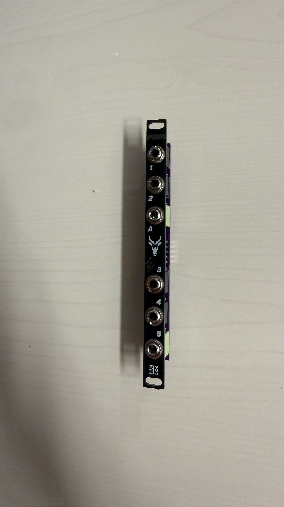
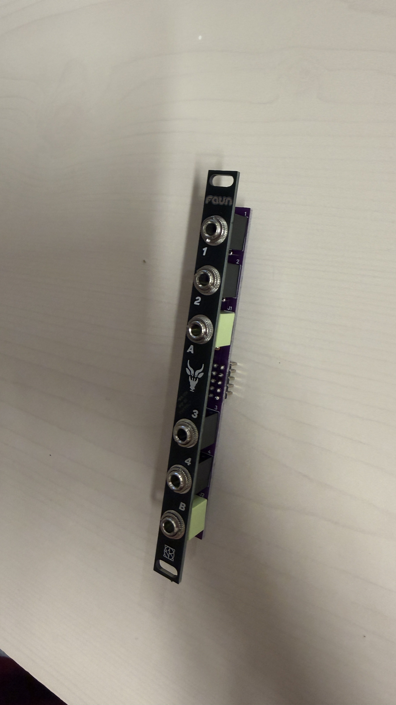

# faun

### A little bit of everything. In 2 HP.

**An open-source passive Eurorack utility and a platform for your own circuits.** Four mono sockets, two TRS sockets and an accessible rear header: configure it with jumpers or change its function with a plug-in **MOD** board.

 

[User manual](docs/USER_MANUAL.md) · [Manuale italiano](docs/MANUALE_IT.md) · [Design your own MOD](docs/DEVELOPMENT.md) · [Schematics](hardware/schematics/README.md) · [Contribute](CONTRIBUTING.md)

## Start with the base module

Its name comes from **“fa un po’ di tutto”** — Italian for “it does a little bit of everything”. The base module has no firmware and requires no Eurorack power connection. Rear jumpers turn the same hardware into:

- Two independent stereo-to-dual-mono breakouts, or compatible CV/gate breakouts.
- Two small passive multiples, or one 1-to-5 passive multiple.
- A TRS MIDI wiring adapter, including Type A/B swapping with the correct front links.
- A MIDI breakout for a host with a compatible expansion header.
- A passive patchbay between two faun modules using internal wiring.

These are alternative configurations. Remove the previous links before fitting another configuration. MIDI functions reroute existing MIDI signals; they do not convert MIDI to CV or provide USB MIDI.

## Pick a MOD

Optional rear-mounted boards replace the base routing. Only the installed board's functions are available.

| Board | What it adds |
| --- | --- |
| MOD1 | Three-channel passive stereo mixer |
| MOD2 | Five-input passive mono mixer |
| MOD3 | Five-bit passive R-2R DAC: 32 theoretical codes for gate combinations |
| MOD4 | Five fixed positions across a stereo panorama |
| MOD5 | Passive XOR and separate positive/negative half-wave outputs |
| MOD6 | Jumper-selectable dual LPG, VC panner or diode clipper |

MOD6 uses passive vactrol/diode circuits; response depends on components and loading. Its panner does not automatically duplicate a single input. MOD3 is not a calibrated pitch DAC. Read the manual's socket maps and all four MOD6 selector positions before patching.

## Connect it correctly

Base splitter links: **X1–Y1, X2–Y2, X3–Y3, X4–Y4**. A tip → 1, A ring → 2; **B tip → 4, B ring → 3**. The lower pair is deliberately reversed: do not copy the upper pair's left/right labels onto it.

For Type A/B MIDI conversion, use those rear links and front TS links **1–3 and 2–4**. Full header and jumper tables are in the [current manual](docs/USER_MANUAL.md).

Power down and unplug cables before changing rear jumpers/MODs. A passive mult distributes one source; use a mixing circuit to combine sources. Passive mixers attenuate and depend on impedance. Use buffered distribution when pitch tracking matters. Do not connect headphones directly.

## Open design and current revision

Current base documentation follows the **3 October 2026 back PCB** and **29 September 2026 V1.2 front-panel design**, with photos of the assembled product. Nominal width: 2 HP; panel design outline 10.16 × 128.50 mm. Installed MODs/wires determine depth.

**Corrected schematics and editable CAD are pending maintainer upload** in [hardware/schematics](hardware/schematics/README.md). Older MOD folders and diagrams remain available as historical references; the current manual above takes precedence for documented routing. This repository is not yet a complete, revision-matched hardware manufacturing release.

## Make it yours

There is no code to flash in the passive base. Modify the routing, build a protoboard backpack or design a MOD using the [header map and development guide](docs/DEVELOPMENT.md). Share your CAD and pinout with a pull request. An active MOD needs its own documented power arrangement; the header is not a Eurorack power connector.

## Files and license

`docs/` contains English/Italian manuals; `images/` contains actual product photos; `hardware/schematics/` is reserved for corrected schematics and editable sources. Existing MOD1–MOD6 folders retain historical materials.

Original project materials: **GNU GPL-3.0**, continuing the repository's existing license. See [LICENSE](LICENSE), [NOTICE](NOTICE.md) and [CONTRIBUTING](CONTRIBUTING.md).

Other E103 projects: [ALTERIA](https://github.com/E103-designs/ALTERIA) · [SINCRIA](https://github.com/E103-designs/SINCRIA)
